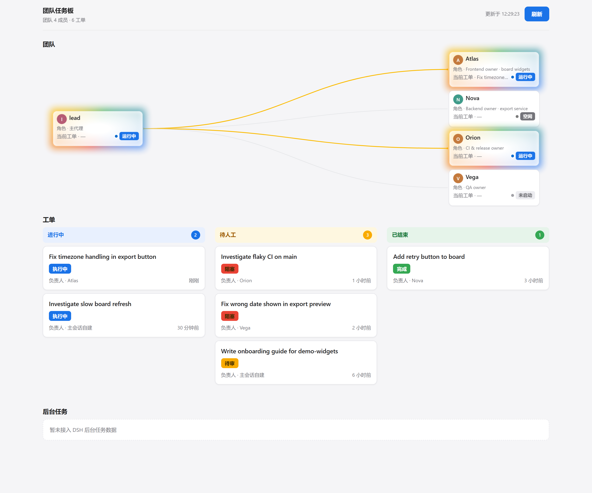
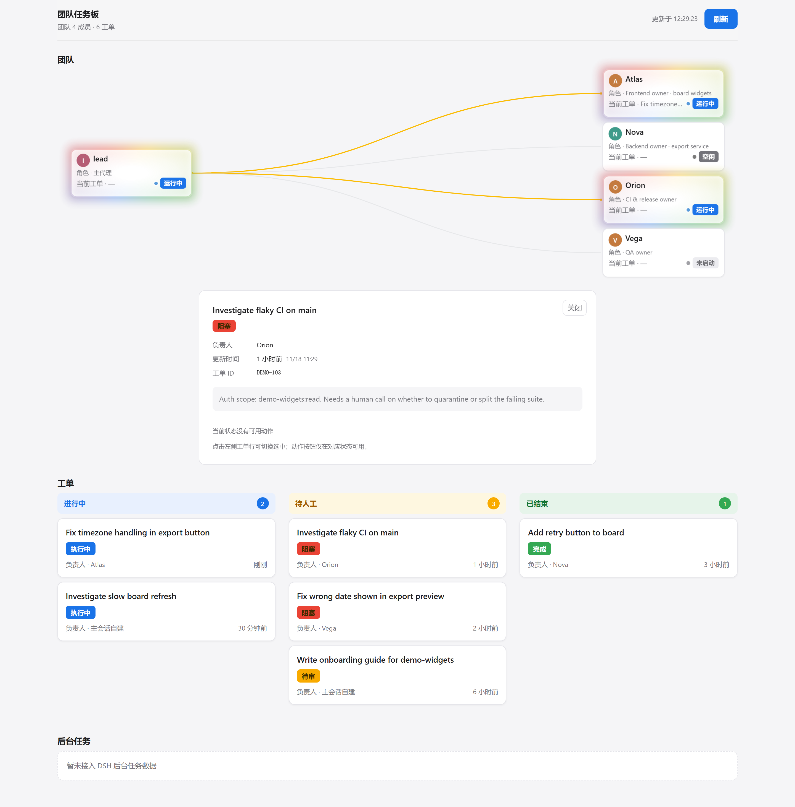
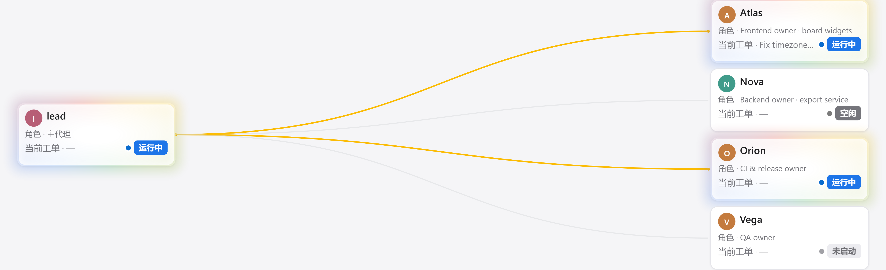
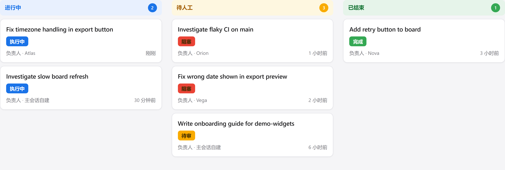
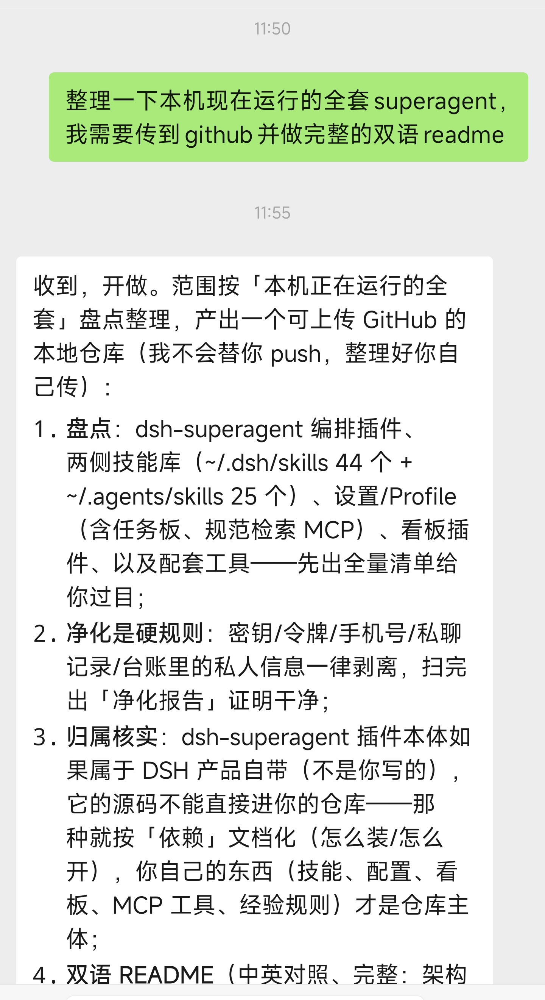
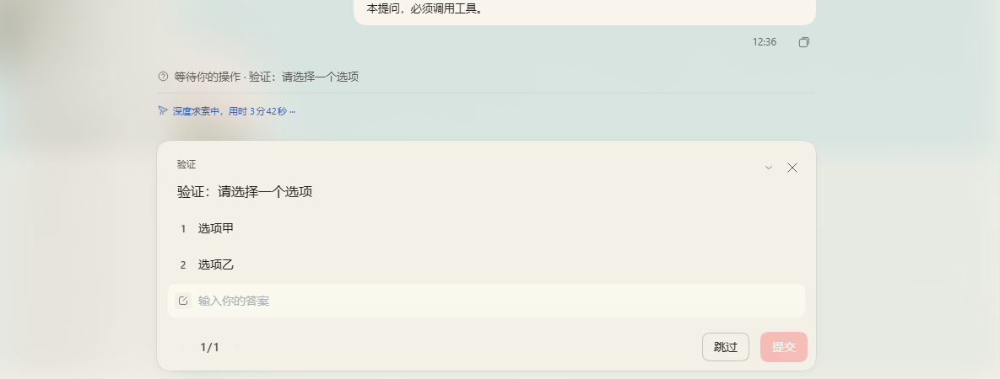
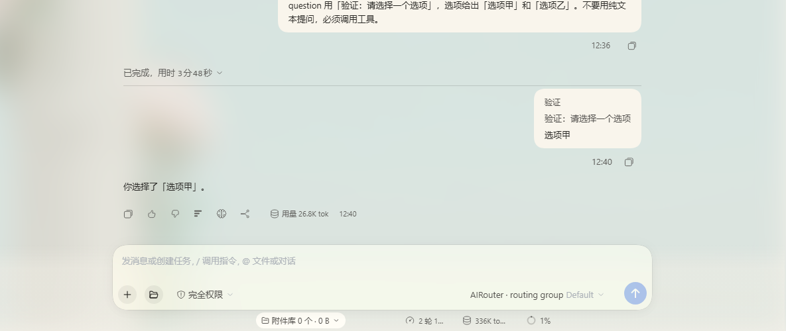
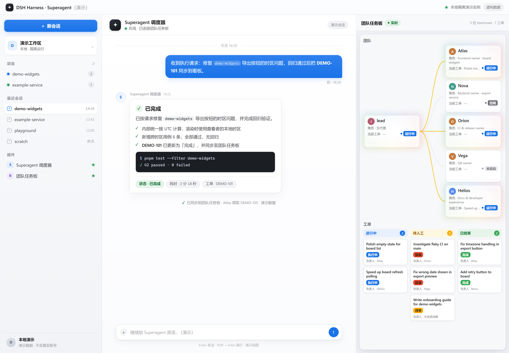
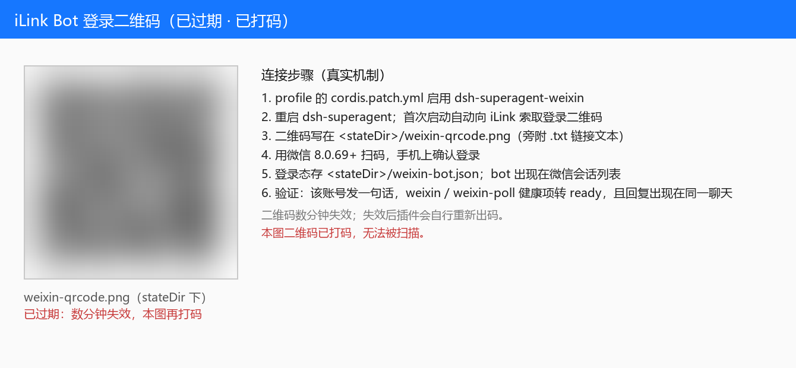

# dsh-superagent (release snapshot)

> **Research prototype for reference only — not an official DeepSeek product.** This
> code grew out of day-to-day development work, with much of the engineering done by
> coding agents. Treat it as research code, not production-ready software. Review and
> adapt it before using it in your own environment. It is derived from the upstream
> research prototype and is **not** identical to the internal version or to the
> implementation described in *Exploring Super-agent Design: Towards a More
> Autonomous Agent System*.
>
> 中文文档：**[README.md](README.md)**

`dsh-superagent` is a **proactive coding agent for one GitHub repository**, packaged as
a bundle for [DeepSeek Harness](https://www.deepseek.com/en/harness/) **0.2+**. It listens
to GitHub and, optionally, Feishu, a local DSH Session, or a personal WeChat account
through its iLink bot. When someone allowed asks the agent for work, it opens a work item
(a **ticket**), works on it in its own agent session and directory, and answers in the
original conversation — for example with a pull request. A web **board** shows what needs
a person.

The working principle: **take as little human attention as possible, and give as much
value as possible.** It acts only when asked, or when a rule the team wrote allows it, and
it speaks only when someone must act or can use a result.

---

## Relationship to DeepSeek Harness (official DSH)

**What DSH is.** [DeepSeek Harness](https://www.deepseek.com/en/harness/) is the **host
platform**: the desktop/web shell, Sessions (the agent runtime and its tool sandbox), the
plugin system (bundles, client plugins, agent presets, personas), the profile/cordis
configuration mechanism, the UI slot API that lets a plugin add sidebar entries and main
panels, and the MCP client. DSH is a separate product and is **not** included in this
repository.

**What this repository is.** Two **third-party plugins that run on top of DSH**:

- `packages/dsh-superagent` — the orchestration plugin;
- `packages/dsh-superagent-board` — the board panel plugin.

It is **not a fork of DSH and does not replace DSH**. Without a DSH host it does not run.

**What the official host provides vs. what this repository provides**

| Provided by DSH (official) | Provided by this repository |
| --- | --- |
| Host shell & web UI, Session runtime, tool sandbox | The orchestration logic: Sources → Eval → Ticket → Assignment → Report/Reply |
| Plugin loading (bundle manifest, client bundle injection, slot registry) | The board panel (sidebar entry + main panel) |
| Profile & `cordis.patch.yml` patch mechanism, profile `node_modules` resolution | Channel adapters: GitHub, Feishu, local DSH Session, WeChat (iLink bot) |
| Agent presets / persona plugin, `tools.restrict` guard | The worker preset the Executors run under, and the team prompt sections |
| Settings UI, MCP client | The **Policy**: admission table, accept modes (`off`/`observe`/`auto`), proactive rules, Mandates |
| MCP client (mount your own MCP servers) | Service scripts: `scripts/dsh-superagent.mjs`, `scripts/install-windows.ps1` |

**Version compatibility (measured on this machine).** Tested against **DSH
`0.2.2-rc.3`**. `scripts/install-windows.ps1` refuses a `dsh` older than **0.2** (0.1.x has
no `--profile`). A DSH upgrade can break:

- the board's client bundle (it injects `@deepseek-ai/dsh-client-*` modules and filters
  `worker-*` sessions through the `sessions` service's `list` store shape and the
  `session:worker-*` row key — both fail **open**, so a host change makes worker rows
  reappear rather than breaking the list);
- the bundle's client `inject` list if the host renames those client packages;
- the worker preset if the preset/persona plugin ids change.

After upgrading DSH, re-run `pnpm --filter dsh-superagent-board smoke` and
`pnpm --filter dsh-superagent check`.

**Dependency boundary.** This repository **does not modify any official DSH file**. It
attaches only through:

1. an `insert` / `config` block in a **profile's** `cordis.patch.yml`;
2. a **junction** under the profile's `node_modules` pointing at the package directory
   (created for you by `dsh plugin --profile <profile> add "link:<path>"`);
3. values you fill in Settings or the profile (e.g. `stateDir`).

Uninstall = remove the insert rows, delete the junctions, delete the profile directory.

---

## Screenshots

All board screenshots come from an **isolated demo instance** (separate profile, separate
port, temporary `stateDir`) running **fabricated** data — fictional teammates, fictional
tickets, no credentials, no real project names.

| Board overview — team at work and ticket spread | Ticket detail — mandate, assignment, report |
| --- | --- |
|  |  |

| Teammates — who is working on what | Blocked / needs a person |
| --- | --- |
|  |  |

### WeChat channel (real usage, sanitized)

The board shots above are a demo instance with fabricated data. The next one is a
**real** WeChat conversation through the iLink bot channel: a person asks for work in
chat and the agent replies with its plan in the same chat.



*Real usage screenshot. Cropped to the conversation bubbles only — the phone status bar,
the app top bar (account / bot name) and the input bar are removed. No credentials,
paths, phone numbers or personal names are visible.*

### Grill question card (isolated instance, cropped and sanitized)

The main Session ships the **grill skill**: it maps a plan or decision onto a question
tree and puts each round of frontier questions into one `ask_user_question` call —
rendered as the official question card: **clickable options, a free-input fallback, and
a skip** control, with the recommended option first. The picked answer returns straight
into the main Session's turn ("你选择了『选项甲』" below), so nobody has to re-type it.

| Question card — options / free input / skip | Answer returned — the turn continues |
| --- | --- |
|  |  |

*Captured on an isolated demo instance (its own profile, port and a rewired, isolated
copy of the state); cropped to the conversation and card area, with the sidebar and the
rest of the transcript removed — no internal project names. Executor (worker) sessions
never receive the tool: only the main Session asks a person.*

## What's in this repository

```
dsh-superagent-release/
├── README.md / README.en.md         bilingual overview (this file)
├── LICENSE                          MIT, shared by both packages
├── SETUP.md                         deployment walkthrough (start here)
├── docs/
│   ├── concepts.md                  the pipeline: eval → dispatch → ticket → teammate → report
│   └── screenshots/                 demo-instance screenshots (fabricated data)
├── examples/
│   ├── profiles/desktop/cordis.patch.example.yml   sanitized profile mount example
│   ├── policy.admission.example.md                 admission table, accept modes, rules
│   └── walkthrough.md                              one message → one ticket → one PR
├── tools/capture-demo-screenshots.mjs              reproduces docs/screenshots/*
└── packages/
    ├── dsh-superagent/              the orchestrator plugin (Sources, Engine, Policy,
    │                                prompts, executor, channels, docs 000–008, tests)
    └── dsh-superagent-board/        the read-only board panel (DSH 0.2.x client plugin)
```

The two packages are independent DSH plugins. `dsh-superagent-board` does not fork or
replace `dsh-better-sidebar`; it registers its own sidebar entry and main panel.

## Architecture: how it works



*Left: session/plugin sidebar; centre: a conversation with the dispatcher and its rich-text
receipt; right: the team board. Demo instance with **fabricated** data (sessions
`demo-widgets` / `example-service`, teammates Atlas·Nova·Orion·Vega·Helios).*

A message travels through five stages; see
[`docs/concepts.md`](docs/concepts.md) and
[`packages/dsh-superagent/docs/`](packages/dsh-superagent/docs/002-authorization.md).
2. **Eval (the gate).** The gate checks the sender and the Source's **Policy**: a listed
   person addressing the agent is an **explicit request**; other messages go through the
   **admission table** and the **accept mode** (`off` / `observe` *(default)* / `auto`).
3. **Dispatch.** The main Session routes explicit candidates with `orchestrator_route`.
   **Accept** creates, atomically, a **Ticket**, its **Mandate**, **Subscriptions**, the
   first **Assignment**, and an acknowledgement reply.
4. **Ticket → Executor → Teammates.** Each Ticket gets its own Executor Session
   (`worker-<ticketId>`) and directory; it can spawn **teammate** sub-sessions. A question
   for a person marks the Ticket `blocked`.
5. **Report / Reply.** The channel writes an **acknowledgement**, an **answer**, a
   **result**, or an **attention** message — each only by the rule that allows it.

See [`docs/concepts.md`](docs/concepts.md) and
[`packages/dsh-superagent/docs/`](packages/dsh-superagent/docs/002-authorization.md).

## How this differs from the official baseline

The honest baselines are (a) **DSH 0.2 base** — the host, which has no proactive
orchestration — and (b) **the upstream research prototype**
([`vHao11/dsh-superagent@windows-adapt`](https://github.com/vHao11/dsh-superagent/tree/windows-adapt)),
Unix-only in practice. What this release adds:

| Area | Baseline | This release |
| --- | --- | --- |
| Proactive orchestration | None in the host | Source → Eval → Ticket → Executor → Report pipeline, policy-gated accept |
| Operating system | Unix-only in practice (`fcntl`, `tmux`, `#!/bin/sh` shims, `bash` tool, `/…`-only paths) | **Windows adaptation**: drive/UNC paths, `PATHEXT`, `pwsh` shell tool, `windowsHide`, case-insensitive paths, `waitForStateLock()`, tmux/fcntl-free service manager, `install-windows.ps1` |
| Service lifecycle on Windows | tmux-based | PID identity check before `taskkill /T /F` (fail-closed), DSH ≥ 0.2 gate, explicit-profiles-only installer |
| Channels | GitHub + Feishu | GitHub, Feishu, **local DSH Session**, **WeChat via iLink bot** |
| Human surface | Terminal / logs | **Board panel** in the DSH sidebar; the **grill question card** (official `ask_user_question`) in the main Session |
| Authorization | Ad-hoc allow-lists | Versioned **Policy** with admission table, accept modes, rules, Mandates |
| Assessment tooling | — | **Eval toolchain** with recorded decisions and re-queue on Policy change |
| Packaging | Research checkout | Monorepo release snapshot with sanitized examples and bilingual docs |

## Why you might pick this (and the pain it removes)

| Capability | Pain it removes |
| --- | --- |
| **Windows-friendly** | Runs on a normal Windows workstation without WSL. Pain removed: "it installs on Windows and then fails at runtime". |
| **WeChat (iLink bot) channel** | Work arrives in chat; results come back in the same chat. Pain removed: copy-pasting between chat and terminal. |
| **Board panel** | Long-running agent work is invisible. Pain removed: "what is the agent doing right now?" |
| **Ticket / dispatch / report orchestration** | Each ticket has its own session, directory, Mandate and thread subscriptions. Pain removed: "which conversation owned this change?" |
| **Policy-gated accept** | `observe` records *would accept* without acting; `auto` acts only on a matching rule. Pain removed: "why did it do that?" |
| **Eval toolchain** | Every assessment judges each enabled rule once; decisions are recorded. Pain removed: no audit trail for proactive actions. |

## When to use it — and when not to

**Good fit:** one repository and one team; a channel people already use; you want branches
and pull requests answered in the same conversation; you will review `observe` decisions
before `auto`; Windows + DSH 0.2+.

**Not a good fit:** you want a polished supported product; you need multi-repo
orchestration; you cannot accept that worker sessions run commands as your OS user, or
that on Windows `blockedCommands` is not enforced for workers.

## Install

Prerequisites: **DSH 0.2+** (tested on `0.2.2-rc.3`) with the `dsh` CLI, **Node.js ≥ 18**,
**pnpm**, **git**, and a **GitHub account for the agent** (a token with repo scope).

```powershell
# 1) clone and build
git clone https://github.com/HiSeax/dsh-superagent.git dsh-superagent-release
cd dsh-superagent-release
pnpm install
pnpm --filter dsh-superagent check                    # typecheck + vitest + build
pnpm --filter dsh-superagent-board build

# 2) create a dedicated profile
$dsh = "C:\Users\<you>\AppData\Local\Programs\DeepSeek Harness\resources\runtime\cli\bin\dsh.cmd"
& $dsh superagent --from-default-profile web

# 3) mount the orchestrator plugin into that profile
#    (this creates the node_modules junction and inserts the plugin rows)
dsh plugin --profile superagent add "link:$PWD\packages\dsh-superagent"

# 4) set stateDir (absolute Windows path) in
#    <DSH_HOME>\profiles\superagent\cordis.patch.yml   →   config.stateDir
#    sanitized example: examples/profiles/desktop/cordis.patch.example.yml

# 5) mount the board panel the same way
dsh plugin --profile superagent add "link:$PWD\packages\dsh-superagent-board"

# 6) start, then check
node packages\dsh-superagent\scripts\dsh-superagent.mjs status --profile superagent   # 0 healthy / 1 down / 2 part failed / 3 waiting for setup
node packages\dsh-superagent\scripts\dsh-superagent.mjs start  --profile superagent
```

`packages/dsh-superagent/cordis.patch.yml` (the bundle layer) is what inserts the plugin
rows; it also ships the GitHub Source enabled and the Feishu / local-Session / Weixin
Sources **disabled** — enable the ones you use in your profile.

### The board panel on its own

```powershell
dsh plugin --profile superagent add "link:$PWD\packages\dsh-superagent-board"
```

That inserts `- id: superagent-board / name: 'dsh-superagent-board'` and links the
package. The sidebar then shows a **Superagent** entry; the panel is served at
`/superagent-board/`. Optionally pin its port with `DSH_SUPERAGENT_BOARD_PORT`.

### WeChat channel (iLink bot) — how to connect (quick QR scan)

**Prerequisites:** a **personal WeChat account** and the **WeChat client 8.0.69 or newer**
(for the phone-side scan). The iLink Bot side needs **no self-built app, no app id and no
secret** — the login itself is established by scanning, and the plugin keeps the
credentials locally.

**Connection steps (QR binding, real mechanism)**

1. Enable the `dsh-superagent-weixin` entry in the profile's `cordis.patch.yml` and
   **restart `dsh-superagent`**.
2. On first start the Source asks iLink for a **login QR code** and writes it to
   `<stateDir>/weixin-qrcode.png` (with a `.txt` link file beside it); the `weixin` health
   entry names both paths. The QR **expires after a couple of minutes** and is refreshed at
   most three times.
3. Scan it with **WeChat 8.0.69+** and confirm on the phone; the login is saved to
   `<stateDir>/weixin-bot.json` (the **Login credentials file** field, configurable) and the
   bot appears in your WeChat chat list (renamable, pinnable).
4. **Verify:** send one message from that WeChat account to the bot — the `weixin` /
   `weixin-poll` health entries flip from “waiting for scan” to “saved login”, and the reply
   arrives in the same chat. The channel is now live.
5. Add the other side's **wxid** (shown in the Trigger) to the Weixin allowed list under
   **Policy** — until then an incoming message is not admitted.
6. To log in again, point **Login credentials file** at another file and restart; a stale
   token (`ret`/`errcode` `-14`) makes the plugin move the old file aside
   (`*.expired-<time>`) and request a new QR by itself.



*The login QR as it appears during binding (real binding screen). The QR is **expired and
masked** — scanning this image does nothing; in real use it is live, lives only inside your
own `<stateDir>`, and expires within minutes. No account names, tokens or phone numbers are
shown.*

**Push window (measured, not the documented 24 hours):** iLink only lets the bot push within
a window after the person's **last** message. Measured, that window closed roughly an hour
after the last inbound message, with `sendMessage` answering `ret=-2 errcode=0 prepare
failed`; once the person wrote again, about ten queued replies went out within 2.5 minutes.
So keep queued replies short-lived instead of hoarding them; a rejected send is recorded on
the `weixin-send` health entry rather than dropped silently.

### WeChat-specific adaptations

Implementation-level, one line per item: **the problem** and **where it lives**.

1. **Talk without opening a ticket** — Problem: a throwaway question in chat should get an answer, not a work item. Implementation: the message enters as a Trigger in `src/core/intake.ts` (`'stored' | 'duplicate' | 'filtered'`), Eval produces a candidate, and the main Session answers with `orchestrator_reply` (`src/app/tools/main.ts`) **without accepting a Ticket**; when a record is wanted, `attach` routes it into a ticket thread (subscription) and later replies follow that thread.
2. **Images both ways** — Problem: send/receive pictures in chat. Implementation: **inbound** goes through `src/sources/weixin-media.ts` (AES-128-ECB decrypt, stored under `<stateDir>/weixin-media/` by content hash) with an `[Image: …]` reference, and the assessing model reads the stored file as an attachment; **outbound** `orchestrator_reply` takes up to **4** `attachments` with a `mime` hint for `image/png`, `image/jpeg`, `image/webp`, `image/gif` (`src/app/tools/main.ts:246-248`), bounded by **Image size limit** (10 MiB default), with prepare / upload / send stages behind `weixin-upload` and `weixin-send`.
3. **Push window and quota** — Problem: iLink pushes are both time- and quota-limited. Implementation: `src/app/outbox.ts` enqueues each reply and records the receipt atomically (a message id enqueues once), retries with `[5s, 300s]` backoff, queues later messages behind an unresolved earlier one (reporting after `FAILURES_BEFORE_ERROR`), accumulates while the window is shut and **flushes when the person writes again** (measured ~10 replies / 2.5 min); settles as dropped only when the conversation is gone.
4. **Long messages** — Problem: the protocol caps a single text. Implementation: `chunkText(text, limit=4000)` in `src/sources/weixin-bot.ts` (`TEXT_CHUNK = 4000`, aligned with CowAgent's Weixin channel) splits at paragraph/line boundaries and sends the pieces; `skills/dsh-superagent-weixin/SKILL.md` additionally constrains replies to 3–6 short bullets.
5. **QR login** — Problem: no app id/secret should be required. Implementation: `src/sources/weixin-qr.ts` renders the login QR as a PNG (+ link text) under `<stateDir>`; `weixin-bot.ts` keeps the login state machine and saves `<stateDir>/weixin-bot.json`; a stale token (`ret/errcode -14`, `isAuthError` in `weixin-api.ts`) moves the old file aside as `*.expired-<time>` and re-logs in under control.
6. **wxid allowlist** — Problem: only authorised people are answered. Implementation: the Policy's `sources.weixin.allowed` (`allowedSender` / admission in `src/policy.ts`; read and written by `src/app/tools/main.ts`); messages from anyone else are not admitted by default.
7. **Long poll and health entries** — Problem: there is no webhook, only long polling, so you need to see whether it is alive. Implementation: long poll in `src/sources/weixin-api.ts` (35 s margin over the server hold); `weixin-bot.ts` reports five health entries — `weixin` (login), `weixin-poll`, `weixin-send`, `weixin-upload`, `weixin-media`; measured, a failed poll recovers to ready in about 90 s, and the host keeps its own cursor so nothing is lost.
8. **Idempotent dedupe** — Problem: re-delivery must not produce duplicate answers. Implementation: `src/core/intake.ts` dedupes by **trigger id** (returns `'duplicate'` when present; only `'stored'` triggers an Eval); `src/app/outbox.ts` dedupes by **message id** (`store.receipts.add` failing means it is not enqueued).
9. **Chinese / formatting** — Problem: WeChat does not render Markdown; tables, bold and code blocks degrade into symbols. Implementation: replies follow the source language (Chinese in Chinese chats); `skills/dsh-superagent-weixin/SKILL.md` requires short bullets and `1 / 2`-style choices instead of Markdown — a **prompt-level** constraint; there is no Markdown→rich-text converter in the code.

### Verify the install

```powershell
node packages\dsh-superagent\scripts\dsh-superagent.mjs status --profile superagent   # expect 0
```

- The one-time **panel URL** (with token) is printed to
  `<stateDir>\.artifacts\dsh-superagent-superagent-*.log`.
- The DSH sidebar shows the **Superagent** entry and the **board** tab; the board page is
  at `/superagent-board/`.
- The orchestrator's health view reports its Sources (`github`, `feishu`, `local`,
  `weixin`, `weixin-poll`, `weixin-send`).

### Common pitfalls

| Symptom | Cause / fix |
| --- | --- |
| Plugin refuses to start | `stateDir` missing — it is required and must be an **absolute** path. |
| "same directory, one host" | A `stateDir` can only be served by one DSH host at a time. |
| Console windows flash on Windows | Fixed by `windowsHide: true` in this release; if you see flashes you are on the upstream build. |
| `blockedCommands` ignored for workers | Known Windows limitation — the worker shim is a `#!/bin/sh` script. Use a dedicated OS account and the agent's own GitHub account. |
| Editing the wrong profile breaks the host | Restore from the sibling `cordis.patch.yml.bak-*`, or remove the `insert` rows you added; worst case delete the profile directory and recreate it. |
| Junction points nowhere | The junction target must exist and be a local path — do not use a network drive. |

## Configuration reference

| What | Where | Example |
| --- | --- | --- |
| Plugin mount, `stateDir`, heartbeat, projects, channels | `<DSH_HOME>\profiles\<profile>\cordis.patch.yml` | [`examples/profiles/desktop/cordis.patch.example.yml`](examples/profiles/desktop/cordis.patch.example.yml) |
| Admission table, accept mode, proactive rules | orchestrator Policy (Settings schemas / Source cards) | [`examples/policy.admission.example.md`](examples/policy.admission.example.md) |
| Executor environment | per Assignment | `DSH_SUPERAGENT_DIR`, `DSH_SUPERAGENT_NAME`, `DSH_SUPERAGENT_TICKET`, `DSH_SUPERAGENT_BLOCKED_COMMANDS` |
| Heartbeat | plugin `config.heartbeat` | `enabled`, `intervalMinutes`, `activeFrom`, `activeTo`, `brief` |

## Skills

The orchestrator works with **any DSH skill library** — it neither ships nor requires a
particular set of skills; point your DSH profile at whichever skills you already use.

The one exception is the bundled **`dsh-superagent-grill`** (shipped with the package and
registered in every session): the asking protocol of a grill interview — a question
tree, frontier rounds, the recommended option first, the free-input fallback kept open,
and facts looked up rather than asked. It pairs with `ask_user_question` in the main
Session only.

## Development

```powershell
pnpm --filter dsh-superagent check
pnpm --filter dsh-superagent-board typecheck
pnpm --filter dsh-superagent-board test
pnpm --filter dsh-superagent-board smoke
```

Some upstream tests are environment-bound on Windows (symlinks, `chmod`, the tmux-based
service-script spec) and fail there by construction — see
[`packages/dsh-superagent/WINDOWS-ADAPT.md`](packages/dsh-superagent/WINDOWS-ADAPT.md).

## Disclaimer and license

- **Research prototype, reference only.** May contain bugs; style and practices may be
  inconsistent. Not identical to any internal version.
- **Not an official DeepSeek product.** DeepSeek Harness is a separate product and is
  **not** included here.
- **Fabricated demo data.** All board screenshots use fictional teammates, tickets and
  projects. The WeChat screenshot is a real conversation, cropped and sanitized.
- License: **MIT** for both packages — see [`LICENSE`](LICENSE). Third-party dependencies
  carry their own licenses.