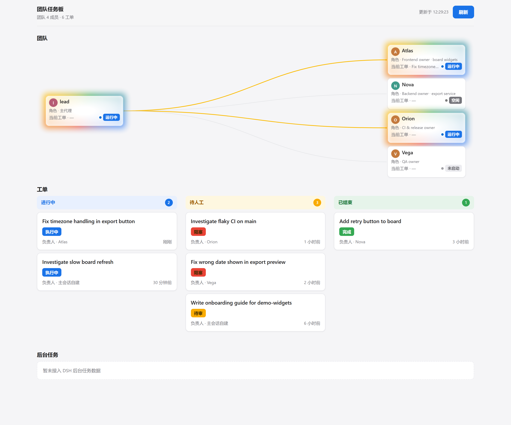
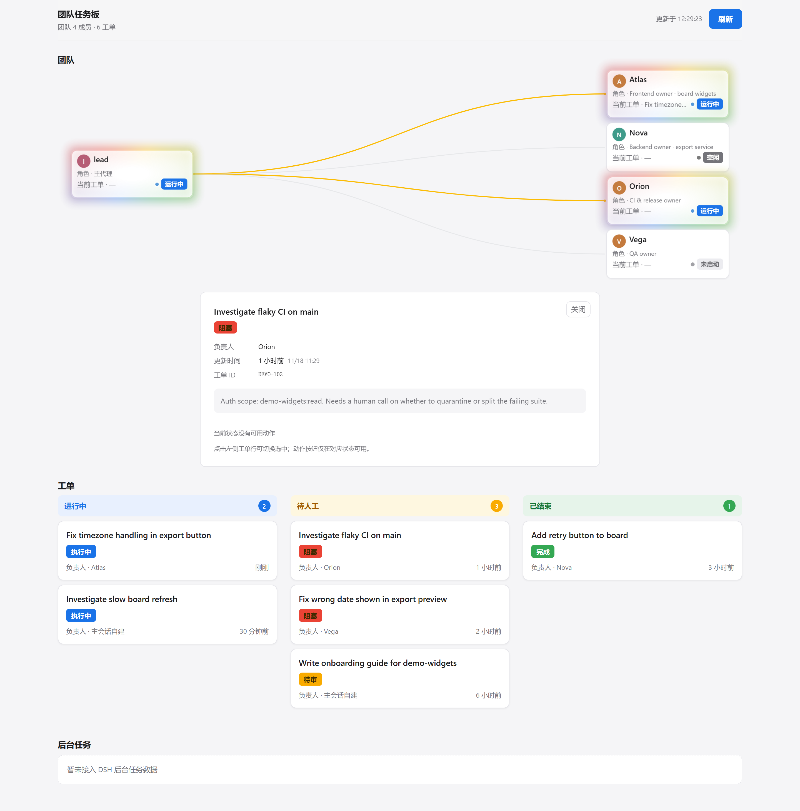
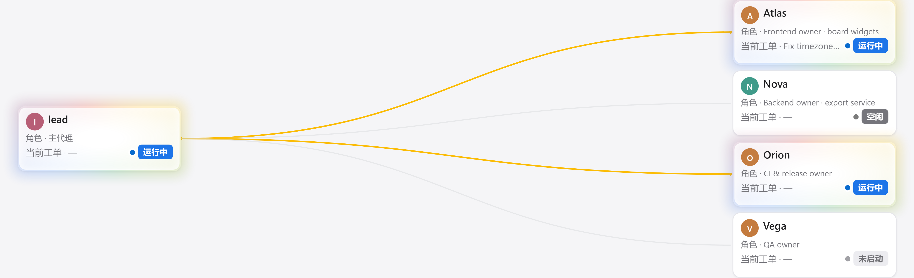
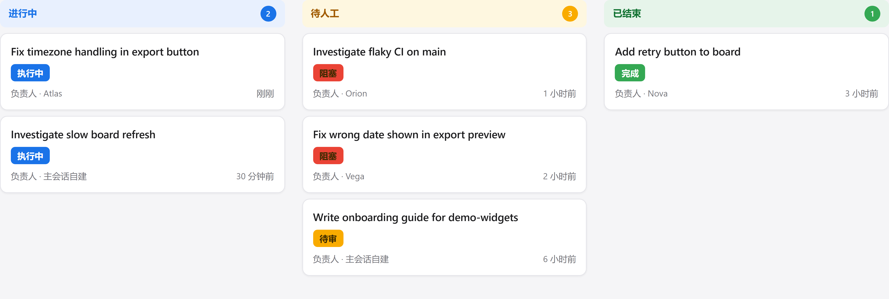
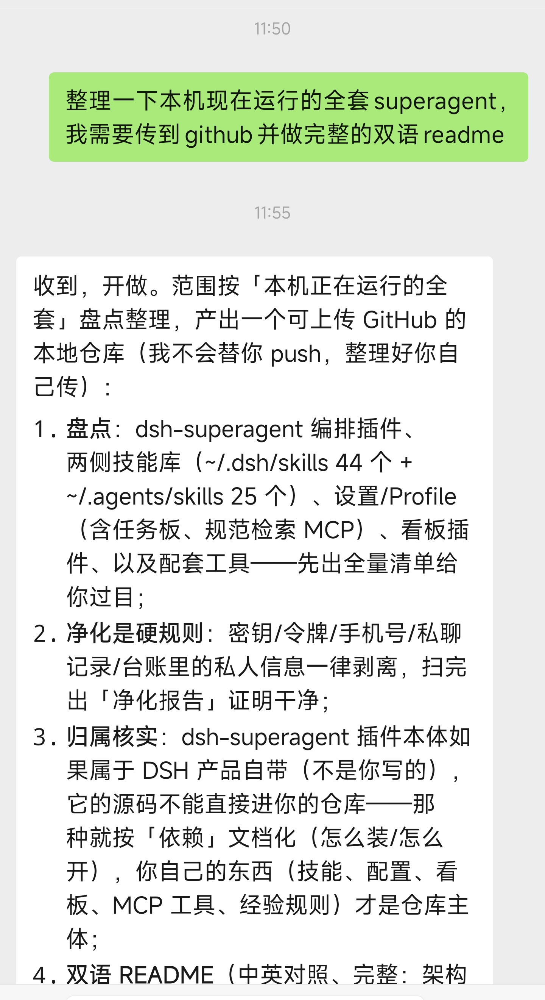
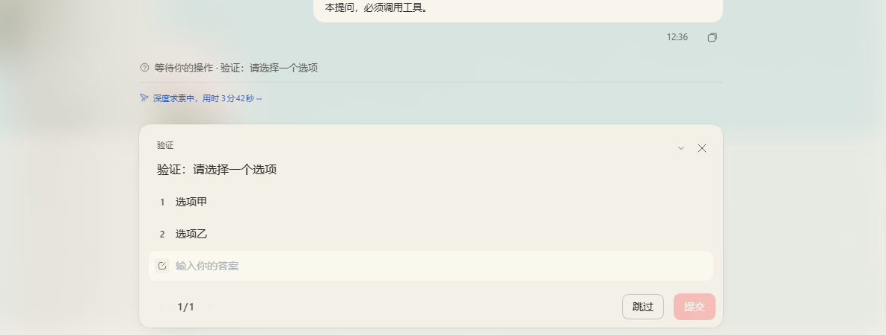

# dsh-windows-superagent

**在 Windows 上跑、以工单为单位、可审核的主动式编码 agent——作为 DSH 插件分发。**

[](LICENSE)
[](SETUP.md)
[](#windows-适配)

> 研究原型，非 DeepSeek 官方产品。由日常开发工作与编码 agent 共同产出，用前请自评。英文：[README.en.md](README.en.md)

---

## 这是什么

两个跑在 [DeepSeek Harness](https://www.deepseek.com/en/harness/)（下称 DSH）之上的第三方插件：

| 包 | 作用 |
| --- | --- |
| `packages/dsh-windows-superagent` | 编排插件：监听通道 → 评估请求 → 开**工单** → 派给 worker 会话 → 回原对话答复 |
| `packages/dsh-windows-superagent-board` | 看板面板：侧栏一个 tab，看谁在干什么、哪些事卡在人这里 |

一条消息进来，它做五件事：**Source → Eval → Ticket → Executor → Report**。
授权范围内才动手，有结果或确实需要人时才说话。

## 能干什么

| 能力 | 用户得到什么 |
| --- | --- |
| **GitHub 可选**（0.2.6） | 不配 GitHub 也能开工：本地 `git` 仓库兜底，缺目录自动 `git init`；配了但探测失败只在面板提示，不阻塞启动 |
| **工单式编排** | 每个工单有自己的会话、目录、Mandate 与线程订阅——改动归哪个对话负责一清二楚 |
| **策略化 accept** | `off` / `observe`（默认，只记 would-accept）/ `auto`（命中规则才动手） |
| **看板** | agent 在干嘛、卡在哪、哪些要人处理，一个页面看完 |
| **通道** | GitHub、飞书、本地 DSH 会话、个人微信（iLink Bot，扫码登录） |
| **选择卡 100 秒超时**（0.2.6） | 无人应答的提问不再无限阻塞会话与消息队列 |
| **Windows 原生** | 盘符/UNC 路径、`pwsh`、`windowsHide`、无 tmux/fcntl，不需要 WSL |

## 适用与不适用

**适用**：一个仓库一个团队；大家已在某个通道里；要开分支开 PR 并回原对话汇报；愿意先 `observe` 再开 `auto`；Windows + DSH 0.2+。

**不适用**：要打磨好的成品；跨多仓库编排；不能接受 worker 以你的 OS 用户身份执行命令（Windows 上 `blockedCommands` 对 worker 不生效）。

## 快速开始

前置：DSH 0.2+（实测 `0.2.2-rc.3`）、Node.js ≥ 18、pnpm、git。

```powershell
git clone https://github.com/HiSeax/dsh-windows-superagent.git
cd dsh-windows-superagent
pnpm install
pnpm --filter dsh-windows-superagent check     # typecheck + 测试 + 构建

dsh plugin --profile superagent add "link:$PWD\packages\dsh-windows-superagent"
dsh plugin --profile superagent add "link:$PWD\packages\dsh-windows-superagent-board"

# 必填：<DSH_HOME>\profiles\superagent\cordis.patch.yml → config.stateDir（Windows 绝对路径）
node packages\dsh-windows-superagent\scripts\dsh-windows-superagent.mjs status --profile superagent  # 0 = 正常
node packages\dsh-windows-superagent\scripts\dsh-windows-superagent.mjs start  --profile superagent
```

> 0.2.6 的 board 包未声明 `dsh.bundle`：上面的 `dsh plugin add`（insert 行挂载）即可用；把它直接写进 `dsh.profile.bundles` 需要 0.2.6 之后的修复（已在 main，见 [docs/ops-notes.md](docs/ops-notes.md) §3）。

更多：**[SETUP.md](SETUP.md)** · 挂载示例 [`examples/profiles/desktop/cordis.patch.example.yml`](examples/profiles/desktop/cordis.patch.example.yml) · 端到端演示 [`examples/walkthrough.md`](examples/walkthrough.md)

## 0.2.6 有什么新东西

| 变更 | 说明 |
| --- | --- |
| 选择卡 100 秒超时 | `ask_user_question` 以 `timed`（100 s）运行；无人应答返回 `pending`，回合继续，卡仍可后答 |
| GitHub 变为可选 | 探测失败 → 面板提示 + 照常运行；未配置 → 静默降级到本地仓库 |
| 本地 git 兜底 | 新增 `executor.repositoryPath`（默认 `<stateDir>/workspace/repo`，缺则 `git init -b main` + 一次空提交） |
| 默认可无远端开工 | `executor.prepare` 为空时，工单目录用 `git worktree add` 准备 |
| 看板刷新按钮并入标题行 | 窄侧栏不再单独占一行，标题行始终单行 |

完整历史：[CHANGELOG.md](CHANGELOG.md)

## 架构

```
消息 ──► Source ──► Eval（Policy 闸门）──► Ticket ──► Executor 会话 ──► Report / Reply
                     │                                  └─ 队友子会话
                     └─ accept 原子落地：Ticket + Mandate + Subscription + 首个 Assignment + 确认回复
```

- **Eval**：在名单上且点名 agent = 显式请求；其他消息走准入表与 accept 模式。
- **工单**：独立会话（`worker-<ticketId>`）与目录；只有人能定的事标 `blocked`。
- **回报**：确认 / 答复 / 结果 / 需要关注——每条都由规则授权。
- **细节**：[`docs/concepts.md`](docs/concepts.md)、[`packages/dsh-windows-superagent/docs/`](packages/dsh-windows-superagent/docs/002-authorization.md)

## 截图

看板截图来自**隔离演示实例**（独立 profile、独立端口、临时 `stateDir`），数据**虚构**。

| 总览 | 工单详情 | 队友 | 需要人处理 |
| --- | --- | --- | --- |
|  |  |  |  |

| 微信通道（真实对话，已脱敏） | Grill 选择卡（隔离实例） |
| --- | --- |
|  |  |

*微信图已裁剪手机状态栏/顶栏/输入栏；选择卡截图来自隔离实例，执行器会话拿不到该工具——只有主控会话向人提问。*

## 通道

| 通道 | 默认 | 要点 |
| --- | --- | --- |
| GitHub | 启用 | 一个仓库一个团队；PR/issue/评论触发，回复回到原线程 |
| 飞书 | 关闭 | 需要 bot 的 `lark-cli` |
| 本地 DSH 会话 | 关闭 | 指定某个普通会话的 id 作为信道 |
| 微信（iLink Bot） | 关闭 | 个人号扫码登录，无需 app id / secret |

<details>
<summary><b>微信通道细节（登录、推送窗口、图片、长消息）</b></summary>

**连接**：启用 `dsh-windows-superagent-weixin` → 重启 → `<stateDir>/weixin-qrcode.png` 出码（数分钟失效，最多自动刷新 3 次）→ 微信 8.0.69+ 扫码确认 → 登录态存 `<stateDir>/weixin-bot.json`。对方 **wxid** 需加入 Policy 的 Weixin allowed list。

**推送窗口**（实测）：iLink 只在对方**最后一条消息之后约 1 小时**内允许主动推送，超时后 `sendMessage` 返回 `ret=-2`。因此排队回复应短命；对方再发一条后积压会补发。被拒的发送记在 `weixin-send` 健康项，不静默丢弃。

**图片**：入站图片解密落到 `<stateDir>/weixin-media/`（按内容哈希），评估模型直接读；出站 `orchestrator_reply` 的 `attachments` 最多 4 张，支持 png/jpeg/webp/gif，单图默认上限 10 MiB。

**长消息**：单条上限 4000 字符，优先在段落/换行处切分后分条发送；微信不渲染 Markdown，回复形态由内置技能约束为短分点与「回 1 / 回 2」。

**健康项**：`weixin`（登录）、`weixin-poll`、`weixin-send`、`weixin-upload`、`weixin-media`。

</details>

## Windows 适配

| 上游（Unix-only） | 本发布 |
| --- | --- |
| `fcntl`、`tmux`、`#!/bin/sh` shim、`bash` 工具、只认 `/…` | 盘符/UNC 路径、`PATHEXT`、`pwsh` shell 工具、`windowsHide`、大小写不敏感路径、无 tmux/fcntl 的服务管理器、`install-windows.ps1` |
| — | `taskkill /T /F` 前做 PID 身份校验（fail-closed）、DSH ≥ 0.2 闸门、安装器只改显式指定的 profile |

已知限制：`blockedCommands` 在 Windows 上**对 worker 不生效**（worker shim 是 `#!/bin/sh` 脚本）。命令隔离重要时，用专用 OS 账户 + agent 自己的 GitHub 账户。

## 配置参考

| 内容 | 位置 |
| --- | --- |
| 插件挂载、`stateDir`、`heartbeat`、通道开关 | `<DSH_HOME>\profiles\<profile>\cordis.patch.yml` |
| `executor.repositoryPath`、`executor.prepare` | 同上（`executor` 块；空 = 默认本地仓库 + worktree） |
| 准入表、accept 模式、主动规则、Mandate | Settings / Source 卡片（Policy schema） |
| 执行器环境变量 | 每个 Assignment：`DSH_SUPERAGENT_DIR`、`DSH_SUPERAGENT_NAME`、`DSH_SUPERAGENT_TICKET`、`DSH_SUPERAGENT_BLOCKED_COMMANDS` |

## 常见坑

<details>
<summary><b>展开</b></summary>

| 现象 | 处理 |
| --- | --- |
| 插件拒绝启动 | 缺 `stateDir`；必填且必须是绝对路径 |
| “同一目录只能一个宿主” | 一个 `stateDir` 同一时间只允许一个 DSH 宿主 |
| 控制台窗口闪 | 本发布已 `windowsHide`；仍闪说明跑的是上游构建 |
| worker 不理会 `blockedCommands` | Windows 已知限制，见上 |
| 改错 profile 起不来 | 用同目录 `cordis.patch.yml.bak-*` 恢复，或删掉你加的 `insert` 行 |
| junction 指向不存在 | 目标必须是存在的本地路径，别用网络盘 |
| 复制 state 后 `setupPending`，或看板读到别的部署 | 见 [docs/ops-notes.md](docs/ops-notes.md)：副本设置仍指向原 `worker-bin`；`DSH_SUPERAGENT_BOARD_PORT` 同时被编排器与看板读取 |

</details>

## 技能

编排器可搭配任意 DSH 技能库，不自带也不要求特定技能。内置只有 **`dsh-windows-superagent-grill`**：一轮访谈的提问协议（问题树、推荐项第一、自由输入兜底、事实自查不问人），只在主控会话配合 `ask_user_question` 使用。

## 开发

```powershell
pnpm --filter dsh-windows-superagent check          # typecheck + vitest + build
pnpm --filter dsh-windows-superagent-board test
pnpm --filter dsh-windows-superagent-board smoke
```

部分上游测试在 Windows 上按构造失败（symlink、`chmod`、tmux 型 service-script spec），原因见
[`WINDOWS-ADAPT.md`](packages/dsh-windows-superagent/WINDOWS-ADAPT.md)。

## 许可与免责

- **研究原型**，可能有 bug，代码风格未必一致；与任何内部版本都不完全等价。
- **非 DeepSeek 官方产品**；DSH 是另一个独立产品，不包含在本仓库。
- 截图：看板为虚构数据；微信截图为真实对话，已裁剪脱敏。
- 许可：两个包均为 **MIT**（见 [LICENSE](LICENSE)），第三方依赖各自持证。
