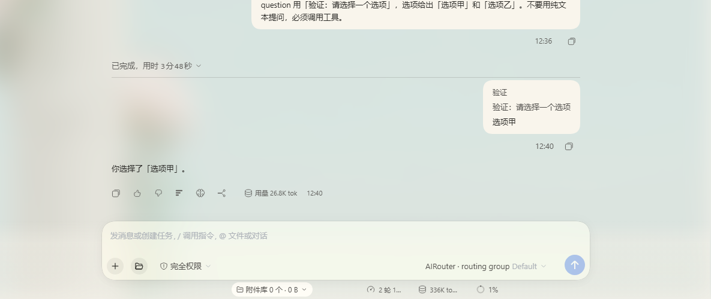
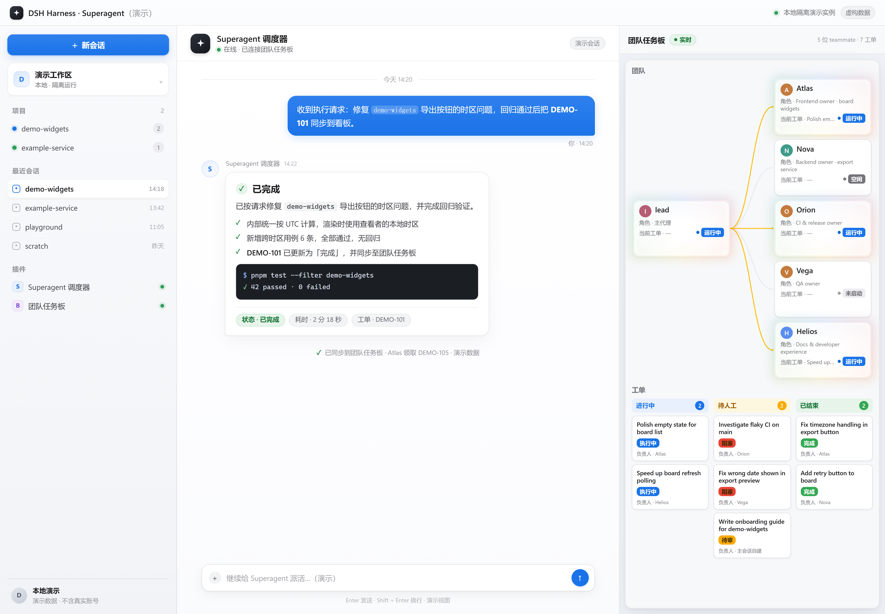

# dsh-superagent（发布快照）

> **仅为研究原型，供参考——不是 DeepSeek 官方产品。** 这套代码来自日常开发工作，其中相当一部分工程由编码 agent 完成。请把它当作研究代码而非可直接上生产线的软件；在你自己的环境使用前请先评审、改造。它由上游研究原型改造而来，**不等于**内部版本，也**不等于**论文《Exploring Super-agent Design: Towards a More Autonomous Agent System》里描述的实现。
>
> English: **[README.en.md](README.en.md)**

`dsh-superagent` 是一个**面向单个 GitHub 仓库的主动式编码 agent**，以 bundle 形式打包给
[DeepSeek Harness](https://www.deepseek.com/en/harness/) **0.2+**。它监听 GitHub，并可选监听飞书、本地 DSH 会话，或通过 iLink Bot 连接个人微信。当被授权的人向它派活时，它会开一个工单（**ticket**），在自己的 agent 会话与目录里完成，然后回到原对话答复——例如给出一个 pull request。一个网页**看板**显示哪些事需要人处理。

工作原则：**尽可能少占用人的注意力，尽可能多地交付价值。** 只有被要求、或团队写下的规则允许时它才行动；只有必须有人处理、或有人能用上结果时它才说话。

---

## 与官方 DSH 的关系

**DSH 是什么。** [DeepSeek Harness](https://www.deepseek.com/en/harness/) 是**宿主平台**：桌面/Web 外壳、会话（Session，即 agent 运行时与其工具沙箱）、插件系统（bundle、客户端插件、agent preset、persona）、profile / cordis 配置机制、允许插件添加侧栏入口与主面板的 **UI slot API**，以及 MCP 客户端。DSH 是另一个独立产品，**不**包含在本仓库里。

**本仓库是什么。** 两个**跑在 DSH 之上的第三方插件**：

- `packages/dsh-superagent` —— 编排插件；
- `packages/dsh-superagent-board` —— 看板面板插件。

它**不是 DSH 的 fork，也不替换 DSH**；没有 DSH 宿主它跑不起来。

**哪些是官方提供、哪些是本仓库提供**

| DSH（官方）提供 | 本仓库提供 |
| --- | --- |
| 宿主外壳与 Web UI、会话运行时、工具沙箱 | 编排逻辑：Sources → Eval → Ticket → Assignment → Report/Reply |
| 插件加载机制（bundle manifest、客户端 bundle 注入、slot 注册表） | 看板面板（侧栏入口 + 主面板） |
| profile 与 `cordis.patch.yml` patch 机制、profile 下 `node_modules` 解析 | 通道适配：GitHub、飞书、本地 DSH 会话、微信（iLink Bot） |
| agent preset / persona 插件、`tools.restrict` 守卫 | 执行器所跑的 worker preset 与团队 prompt 分节 |
| Settings UI、MCP 客户端（可自行挂 MCP server） | **Policy 策略**：准入表、accept 模式（`off`/`observe`/`auto`）、主动规则、Mandate |
| MCP 客户端 | 服务脚本：`scripts/dsh-superagent.mjs`、`scripts/install-windows.ps1` |

**版本兼容（本机实测）**：实测 **DSH `0.2.2-rc.3`**。`scripts/install-windows.ps1` 会拒绝低于 **0.2** 的 `dsh`（0.1.x 没有 `--profile`）。升级 DSH 可能破坏：

- 看板客户端 bundle（它注入 `@deepseek-ai/dsh-client-*` 模块，并通过 `sessions` 服务的 `list` store 形状与 `session:worker-*` 行键过滤 `worker-*` 会话——两者都是 **fail-open**，宿主改动只会让 worker 行重新显示，不会把列表搞坏）；
- 若宿主改名了 bundle 的 client `inject` 里的那些 client 包，注入会失败；
- 若 preset / persona 插件的 id 变化，会影响 worker preset。

升级 DSH 后请重跑 `pnpm --filter dsh-superagent-board smoke` 与 `pnpm --filter dsh-superagent check`。

**依赖边界**：本仓库**不修改任何 DSH 官方文件**，只通过三种方式挂上去：

1. 在 **profile 的** `cordis.patch.yml` 里加 `insert` / `config` 块；
2. 在 profile 的 `node_modules` 下建一个指向包目录的 **junction**（`dsh plugin --profile <profile> add "link:<路径>"` 会替你建）；
3. 在 Settings 或 profile 里填你自己的值（例如 `stateDir`）。

卸载 = 移除 insert 行 + 删 junction + 删 profile 目录。

---

## 截图

所有看板截图都来自**隔离的演示实例**（独立 profile、独立端口、临时 `stateDir`），运行的是**虚构**数据——虚构队友、虚构工单，无任何真实凭据、真实项目名或用户路径。

| 看板总览——谁在干什么、工单分布 | 工单详情——授权范围、任务、回报 |
| --- | --- |
|  |  |

| 队友——各自动作 | 需要人处理的事项 |
| --- | --- |
|  |  |

### 微信通道（真实使用截图，已脱敏）

上面的看板图来自演示实例、数据虚构；下面这张是 iLink Bot 通道里的**真实**微信对话：有人在聊天里派活，agent 在同一个聊天里回复它的执行方案。


*真实使用截图。已裁剪到对话气泡区域——手机状态栏、应用顶栏（账号 / 机器人名）与底部输入栏均已去掉；画面中不含凭据、路径、手机号或人名。*

### Grill 选择卡（隔离实例实测截图，已裁剪脱敏）

主 Session 内置 **grill 技能**：把一个计划或决策拆成问题树，每轮把「当前能问的问题」放进一次 `ask_user_question` 调用——渲染成官方选择卡：**选项可点、自由输入兜底、可跳过**，推荐项排第一。作答后答案直接回到主 Session 的回合里继续推理（下右图「你选择了『选项甲』」），不需要人再复述一遍。

| 选择卡——选项 / 自由输入 / 跳过 | 作答回传——回合继续 |
| --- | --- |
|  |  |

*隔离演示实例（独立 profile、独立端口、克隆后隔离的数据快照）实测截图；已裁剪到对话与卡片区域，去掉侧栏与其余转录，不含内部项目名。执行器（worker）会话拿不到这个工具——只有主控会话向人提问。*

## 仓库里有什么

```
dsh-superagent-release/
├── README.md / README.en.md         双语总览（本文件）
├── LICENSE                          MIT，两个子包共用
├── SETUP.md                         部署速览（从这里开始）
├── docs/
│   ├── concepts.md                  流水线：评估 → 派单 → 工单 → 队友 → 回报
│   └── screenshots/                 演示实例截图（虚构数据）
├── examples/
│   ├── profiles/desktop/cordis.patch.example.yml   脱敏的 profile 挂载示例
│   ├── policy.admission.example.md                 准入表、accept 模式、主动规则
│   └── walkthrough.md                              一条消息 → 一个工单 → 一个 PR
├── tools/capture-demo-screenshots.mjs              复现 docs/screenshots/* 的脚本
└── packages/
    ├── dsh-superagent/              编排插件本体（Sources、Engine、Policy、提示词、
    │                                执行器、通道、docs 000–008、测试）
    └── dsh-superagent-board/        只读看板面板（DSH 0.2.x 客户端插件）
```

两个包是相互独立的 DSH 插件。`dsh-superagent-board` **不 fork、也不替换** `dsh-better-sidebar`，它注册自己的侧栏入口与主面板。

## 架构：它是怎么工作的（Architecture）



*左：会话/插件侧栏；中：与 dispatcher 的对话与富文本回执；右：团队任务板。演示实例 · 虚构数据（会话 `demo-widgets` / `example-service`，队友 Atlas·Nova·Orion·Vega·Helios）。*

一条消息经过五个阶段。每个阶段的规范描述见
[`packages/dsh-superagent/docs/`](packages/dsh-superagent/docs/002-authorization.md)。
2. **Eval（闸门）。** 检查发送者与该 Source 的 **Policy**：在名单上且指向 agent 的人是**显式请求**；其他消息走**准入表**与 **accept 模式**（`off` / `observe`（默认）/ `auto`）。
3. **派单（Dispatch）。** 主会话用 `orchestrator_route` 处置显式候选（accept / attach / stop / ignore）。**accept** 原子地创建：**Ticket**、其 **Mandate**、对该线程的 **Subscriptions**、首个 **Assignment**，以及一条确认回复。
4. **工单 → 执行器 → 队友。** 每个工单有自己的执行器会话（`worker-<ticketId>`）与目录；可派生**队友**子会话。遇到只有人能定的事，工单标记 `blocked`。
5. **回报 / 回复。** 通道写**确认**、**答复**、**结果**或**需要关注**——每一条都必须有允许它的规则。

详见 [`docs/concepts.md`](docs/concepts.md) 与
[`packages/dsh-superagent/docs/`](packages/dsh-superagent/docs/002-authorization.md)。

## 与官方基线的区别

诚实基线是两个：①**DSH 0.2 基础版**——宿主没有主动式编排；②**本代码源自的上游研究原型**
（[`vHao11/dsh-superagent@windows-adapt`](https://github.com/vHao11/dsh-superagent/tree/windows-adapt)），实践上 **Unix-only**。本发布增加了：

| 方面 | 基线 | 本发布 |
| --- | --- | --- |
| 主动式编排 | 宿主没有 | Source → Eval → Ticket → Executor → Report 流水线，接受动作受策略闸门约束 |
| 操作系统 | 实践上 Unix-only（`fcntl`、`tmux`、`#!/bin/sh` shim、`bash` 工具、只认 `/…` 路径） | **Windows 适配**：盘符/UNC 路径、`PATHEXT`、`pwsh` shell 工具、`windowsHide`、大小写不敏感路径、`waitForStateLock()`、无 tmux/fcntl 的服务管理器、`install-windows.ps1` |
| Windows 上的服务生命周期 | 面向 tmux | `taskkill /T /F` 前做 PID 身份校验（fail-closed）、DSH ≥ 0.2 闸门、安装器只改显式指定的 profile |
| 通道 | GitHub + 飞书 | GitHub、飞书、**本地 DSH 会话**、**微信（iLink Bot）** |
| 人的界面 | 终端 / 日志 | DSH 侧栏里的**看板**；主控会话的 **grill 选择卡**（官方 `ask_user_question`） |
| 授权 | 临时 allow-list | 有版本的 **Policy**：准入表、accept 模式、规则、Mandate |
| 评估工具链 | — | **Eval 工具链**：决策留痕、Policy 变更后重排队 |
| 打包 | 研究性 checkout | 单仓发布快照 + 脱敏示例 + 双语文档 |

## 为什么选用（解决什么痛点）

| 能力 | 痛点 |
| --- | --- |
| **Windows 友好** | 普通 Windows 工作站直接跑，不需要 WSL。痛点：装得上、跑不起来。 |
| **微信通道（iLink Bot）** | 派活在聊天里发生，结果回同一个聊天。痛点：聊天与终端之间来回复制。 |
| **看板** | agent 长时间工作不可见。痛点：它现在在干嘛？ |
| **工单 / 派单 / 回执编排** | 每个工单有自己的会话、目录、Mandate、线程订阅。痛点：这个改动是哪个对话负责的？ |
| **策略化 accept** | `observe` 只记 *would accept* 不动手；`auto` 只在命中规则时动手。痛点：它为什么做这个？ |
| **Eval 工具链** | 每次评估对每条规则各判一次，决策留痕。痛点：主动动作没有审计痕迹。 |

## 什么时候该用，什么时候不必

**合适**：一个仓库一个团队；大家已在用某个通道；想要开分支开 PR 并在原对话回报；愿意先看 `observe` 决策再开 `auto`；Windows + DSH 0.2+。

**不合适**：想要打磨过的成品；需要跨多仓库编排；不能接受 worker 以你的 OS 用户身份执行命令，或 Windows 上 `blockedCommands` 对 worker 不生效。

## 安装方法

前置：**DSH 0.2+**（实测 `0.2.2-rc.3`）与 `dsh` CLI、**Node.js ≥ 18**、**pnpm**、**git**，以及一个 **agent 用的 GitHub 账户**（有 repo 权限的 token）。

```powershell
# 1) 克隆并构建
git clone https://github.com/HiSeax/dsh-superagent.git dsh-superagent-release
cd dsh-superagent-release
pnpm install
pnpm --filter dsh-superagent check                    # typecheck + vitest + build
pnpm --filter dsh-superagent-board build

# 2) 建一个专用 profile
$dsh = "C:\Users\<you>\AppData\Local\Programs\DeepSeek Harness\resources\runtime\cli\bin\dsh.cmd"
& $dsh superagent --from-default-profile web

# 3) 把编排插件挂到该 profile
#    （这一步会在 profile 的 node_modules 下建 junction，并插入插件行）
dsh plugin --profile superagent add "link:$PWD\packages\dsh-superagent"

# 4) 填 stateDir（必须是 Windows 绝对路径）：
#    编辑 <DSH_HOME>\profiles\superagent\cordis.patch.yml  →  config.stateDir
#    脱敏示例：examples/profiles/desktop/cordis.patch.example.yml

# 5) 用同样方式挂看板
dsh plugin --profile superagent add "link:$PWD\packages\dsh-superagent-board"

# 6) 启动并检查
node packages\dsh-superagent\scripts\dsh-superagent.mjs status --profile superagent   # 0 正常 / 1 挂了 / 2 部分失败 / 3 等待初始化
node packages\dsh-superagent\scripts\dsh-superagent.mjs start  --profile superagent
```

包内的 `packages/dsh-superagent/cordis.patch.yml`（bundle 层）负责插入插件行；它默认启用 GitHub 源，而飞书 / 本地会话 / 微信源是 **disabled** 的——用哪个就在你的 profile 里启用哪个。

### 看板单独挂载

```powershell
dsh plugin --profile superagent add "link:$PWD\packages\dsh-superagent-board"
```

它会插入 `- id: superagent-board / name: 'dsh-superagent-board'` 并链接该包。之后侧栏出现 **Superagent** 入口，面板地址为 `/superagent-board/`；可用 `DSH_SUPERAGENT_BOARD_PORT` 固定端口。

### 微信通道（iLink Bot）——怎么连接（快捷扫码）

**前提**：一个**个人微信号**，以及**微信客户端 8.0.69 或更新**（手机端扫码用）。iLink Bot 侧**不需要自建应用、不需要 app id / secret**——登录本身通过扫码建立，凭据由插件保存在本地。

**连接步骤（扫码绑定，真实机制）**

1. 在 profile 的 `cordis.patch.yml` 里启用 `dsh-superagent-weixin`，**重启 `dsh-superagent`**。
2. 首次启动时该源会向 iLink 索取**登录二维码**，写在 `<stateDir>/weixin-qrcode.png`（旁边附一个 `.txt` 链接文本）；`weixin` 健康项会指出这两个文件路径。二维码**数分钟即失效**，插件最多自动刷新 3 次。
3. 用**微信 8.0.69+** 扫该图并在手机上确认登录；登录态保存到 `<stateDir>/weixin-bot.json`（即 **Login credentials file** 字段，可改），bot 会出现在你的微信会话列表里（可重命名/置顶）。
4. **验证**：用那个微信号给 bot **发一句话**——`weixin` / `weixin-poll` 健康项从“等待扫码”转为“已保存登录”，回复出现在同一聊天里，即通道已通。
5. 把对方的 **wxid**（Trigger 里会显示）加入 **Policy** 下的 Weixin allowed list，否则来消息默认不被接纳。
6. 再次登录：把 **Login credentials file** 指向另一个文件后重启；token 过期（`ret`/`errcode` `-14`）时插件会把旧文件挪成 `*.expired-<时间>` 并自行重新出码。


*登录二维码示意（来自真实绑定界面）。二维码**已过期且已打码**——扫这张图不会有任何效果；实际使用时它是活的、只在你自己的 `<stateDir>` 里、数分钟失效。图中不含账号名、token 或手机号。*

**推送窗口（实测，非文档宣称的 24 小时）**：iLink 只允许 bot 在对方**最后一条消息之后的一段时间内**主动推送。实测该窗口大约在最后入站后约 1 小时关闭，之后 `sendMessage` 返回 `ret=-2 errcode=0 prepare failed`；对方再发一条后，队列里约 10 条回复在 2.5 分钟内发出。因此排队回复应短命、不要囤积；被拒的发送会记在 `weixin-send` 健康项，而不是静默丢弃。

### 微信本地化适配（WeChat-specific adaptations）

这一节只写“具体改了什么、怎么实现”，每条：**解决了什么** + **实现位置**。

1. **不需要工单即可对话** —— 解决：用户在微信里随口一问就该有回应，不必先建工单。实现：消息作为 Trigger 进 `src/core/intake.ts`（返回 `'stored' / 'duplicate' / 'filtered'`）→ Eval 出候选 → 主会话用 `orchestrator_reply`（`src/app/tools/main.ts`）直接回复，**不经 accept 建工单**；需要建档时再用 `attach` 把消息挂到工单线程（订阅），后续回复走该线程。
2. **图片双向** —— 解决：微信里发图/收图要能用。实现：**收** 入站图片走 `src/sources/weixin-media.ts`（AES-128-ECB 解密、按内容哈希落 `<stateDir>/weixin-media/`），消息带 `[Image: …]` 引用，评估模型把落盘图当附件直接读；**发** `orchestrator_reply` 的 `attachments` 最多 **4 张**，`mime` 支持 `image/png`、`image/jpeg`、`image/webp`、`image/gif`（`src/app/tools/main.ts:246-248`），单图受 **Image size limit**（默认 10 MiB）约束，上传分 prepare/upload/send 三段并分别记 `weixin-upload`、`weixin-send`。
3. **推送窗口与额度管理** —— 解决：iLink 主动推送有时限和额度，发出去不等于发到了。实现：`src/app/outbox.ts` 入队并原子记账（同一条消息 id 只入队一次），失败按 `[5s, 300s]` 退避重试；同一工单/会话的前一条未发完时后续排队（超过 `FAILURES_BEFORE_ERROR` 才显式报错）；窗口关闭时积压，**用户再发一句后自动补发**（实测约 10 条/2.5 分钟）；目标会话已不存在时 settle 为 dropped。
4. **长消息处理** —— 解决：微信单条文本有上限，长回复会被截断。实现：`src/sources/weixin-bot.ts` 的 `chunkText(text, limit=4000)`（`TEXT_CHUNK = 4000`，对齐 CowAgent 的 Weixin 通道），优先在段落/换行处切分后**分条发送**；同时在 `skills/dsh-superagent-weixin/SKILL.md` 约束回复形态（3–6 条短分点）。
5. **扫码登录** —— 解决：不想为通道再申请 app id/secret。实现：`src/sources/weixin-qr.ts` 把登录二维码渲染成 PNG（+ link 文本）写到 `<stateDir>`；`weixin-bot.ts` 的登录状态机把登录态存 `<stateDir>/weixin-bot.json`；token 过期（`ret/errcode -14`，`weixin-api.ts` 的 `isAuthError`）时旧文件挪成 `*.expired-<时间>` 并受控重新登录。
6. **wxid 白名单** —— 解决：只响应被授权的人。实现：Policy 的 `sources.weixin.allowed`（`src/policy.ts` 的 `allowedSender`/准入判断；`src/app/tools/main.ts` 里读写该名单）；不在名单的来消息默认不接纳。
7. **长轮询与健康项** —— 解决：微信没有 webhook 只能长轮询，且要能看出“通没通”。实现：`src/sources/weixin-api.ts` 长轮询（超时留 35s 余量）；`weixin-bot.ts` 上报五个健康项 `weixin`（登录）/`weixin-poll`/`weixin-send`/`weixin-upload`/`weixin-media`；实测一次 failed poll 约 90 秒后自愈为 ready，宿主保留自己的游标不丢消息。
8. **幂等去重** —— 解决：平台重投或重复送达时不能重复应答。实现：`src/core/intake.ts` 以 **trigger id** 判重（已存在即返回 `'duplicate'`，只有 `'stored'` 才触发评估）；`src/app/outbox.ts` 对**消息 id** 去重（`store.receipts.add` 失败则不入队）。
9. **中文/格式适配** —— 解决：微信不渲染 Markdown，表格/加粗/代码块都会退化成符号。实现：回复语言按来源（中文场景用中文）；`skills/dsh-superagent-weixin/SKILL.md` 明确要求不用 Markdown/表格/加粗/代码块，改用短分点与「回 1 / 回 2」选项——这是**提示词层**约束（代码中没有 Markdown→富文本转换器）。

### 验证安装成功

```powershell
node packages\dsh-superagent\scripts\dsh-superagent.mjs status --profile superagent   # 期望 0
```

- 一次性**面板 URL**（带 token）打印在 `<stateDir>\.artifacts\dsh-superagent-superagent-*.log`。
- DSH 侧栏出现 **Superagent** 入口与**看板** tab；看板页面在 `/superagent-board/`。
- 编排器健康视图会报告各 Source（`github`、`feishu`、`local`、`weixin`、`weixin-poll`、`weixin-send`）。

### 常见坑

| 现象 | 原因 / 处理 |
| --- | --- |
| 插件拒绝启动 | 缺 `stateDir`——它必填且必须是**绝对**路径。 |
| “同一目录只能一个宿主” | 一个 `stateDir` 同一时间只能被一个 DSH 宿主加载。 |
| Windows 上控制台窗口闪 | 本发布已用 `windowsHide: true` 修掉；若仍闪，说明跑的是上游构建。 |
| worker 不理会 `blockedCommands` | Windows 已知限制——worker shim 是 `#!/bin/sh` 脚本。请用专用 OS 账户 + agent 自己的 GitHub 账户。 |
| 改错 profile 导致宿主起不来 | 用同目录的 `cordis.patch.yml.bak-*` 恢复，或删掉你加的 `insert` 行；最坏情况删掉该 profile 目录重建。 |
| junction 指向不存在 | junction 目标必须存在且是本地路径——别用网络盘。 |
| 复制的 state 目录一直 `setupPending` / `agentCliSignedOut`；副本的 `/board.json` 返回另一个部署的数据 | 见 **[docs/ops-notes.md](docs/ops-notes.md)**——复制来的设置仍指向原 `worker-bin` 里的 CLI 垫片；`DSH_SUPERAGENT_BOARD_PORT` 同时被编排器与看板插件读取。 |

## 配置参考

| 内容 | 位置 | 示例 |
| --- | --- | --- |
| 插件挂载、`stateDir`、心跳、项目、通道 | `<DSH_HOME>\profiles\<profile>\cordis.patch.yml` | [`examples/profiles/desktop/cordis.patch.example.yml`](examples/profiles/desktop/cordis.patch.example.yml) |
| 准入表、accept 模式、主动规则 | 编排器 Policy（Settings schemas / Source 卡片） | [`examples/policy.admission.example.md`](examples/policy.admission.example.md) |
| 执行器环境变量 | 每个 Assignment 设置 | `DSH_SUPERAGENT_DIR`、`DSH_SUPERAGENT_NAME`、`DSH_SUPERAGENT_TICKET`、`DSH_SUPERAGENT_BLOCKED_COMMANDS` |
| 心跳 | 插件 `config.heartbeat` | `enabled`、`intervalMinutes`、`activeFrom`、`activeTo`、`brief` |

> Windows 注意：`blockedCommands` 在 Windows 上**对 worker 不生效**。若命令隔离重要，请用 agent 自己的 GitHub 账户与专用 OS 账户。

## 技能（Skills）

编排器可搭配**任意 DSH 技能库**使用——它不自带、也不要求某套特定技能；把你的 DSH profile 指向你已经在用的技能即可。

例外是内置的 **`dsh-superagent-grill`**（随包分发、每个会话注册）：一轮 grill 访谈的提问协议——问题树、前沿轮次、推荐项第一、自由输入兜底、事实自查不问人；只在主控会话里配合 `ask_user_question` 用。

## 开发

```powershell
pnpm --filter dsh-superagent check
pnpm --filter dsh-superagent-board typecheck
pnpm --filter dsh-superagent-board test
pnpm --filter dsh-superagent-board smoke
```

部分上游测试在 Windows 上受环境限制（symlink、`chmod`、基于 tmux 的 service-script spec）而按构造失败——见
[`packages/dsh-superagent/WINDOWS-ADAPT.md`](packages/dsh-superagent/WINDOWS-ADAPT.md)。

## 免责与许可

- **研究原型，仅供参考。** 可能仍有 bug，代码风格与工程实践可能不一致。与任何内部版本都不完全一致。
- **不是 DeepSeek 官方产品。** DeepSeek Harness 是另一个产品，**不**包含在本仓库里。
- **截图数据说明。** 看板截图为虚构数据；微信截图是真实对话，已裁剪并脱敏。
- 许可：两个包均为 **MIT**——见 [`LICENSE`](LICENSE)。第三方依赖各自带自己的许可。
