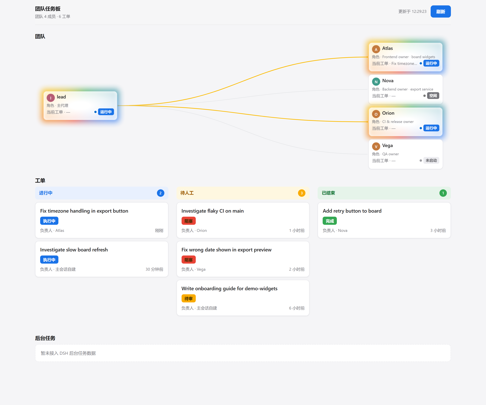
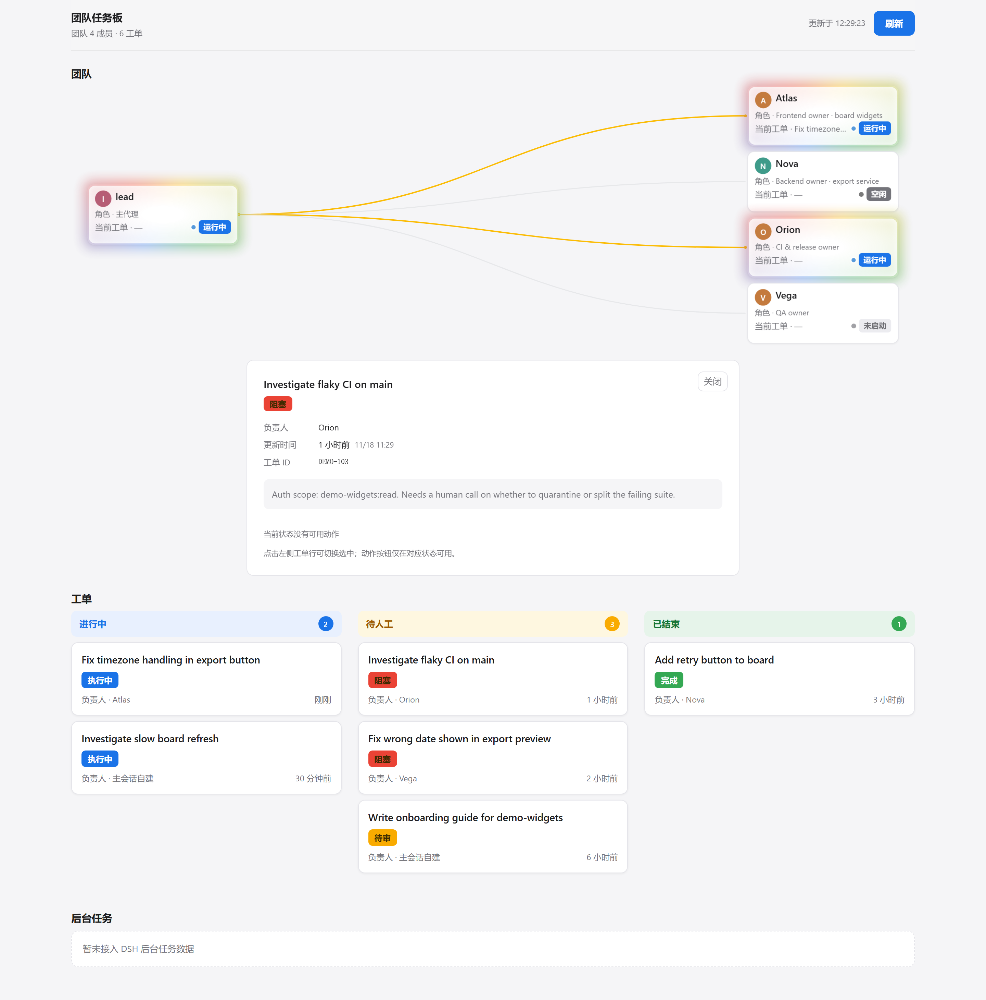
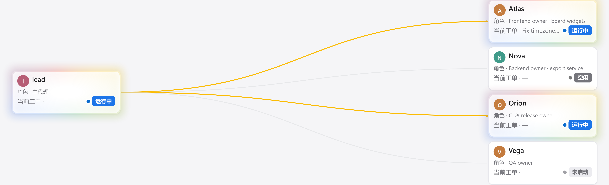
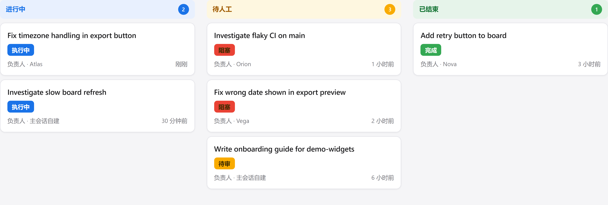
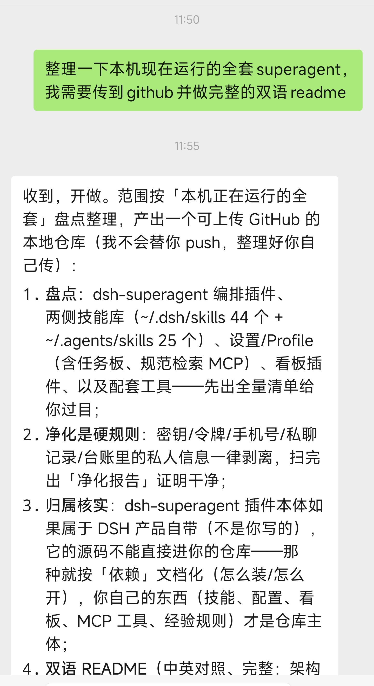

# dsh-superagent（发布快照）

> **仅为研究原型，供参考——不是 DeepSeek 官方产品。** 这套代码来自日常开发工作，其中相当一部分工程由编码 agent 完成。请把它当作研究代码而非可直接上生产线的软件；在你自己的环境使用前请先评审、改造。它由上游研究原型改造而来，**不等于**内部版本，也**不等于**论文《Exploring Super-agent Design: Towards a More Autonomous Agent System》里描述的实现。
>
> English: **[README.md](README.md)**

`dsh-superagent` 是一个**面向单个 GitHub 仓库的主动式编码 agent**，以 bundle 形式打包给
[DeepSeek Harness](https://www.deepseek.com/en/harness/) **0.2+**。它监听 GitHub，并可选监听飞书、本地 DSH 会话，或通过 iLink Bot 连接个人微信。当被授权的人向它派活时，它会开一个工单（**ticket**），在自己的 agent 会话与目录里完成，然后回到原对话答复——例如给出一个 pull request。一个网页**看板**显示哪些事需要人处理。

工作原则：**尽可能少占用人的注意力，尽可能多地交付价值。** 只有被要求、或团队写下的规则允许时它才行动；只有必须有人处理、或有人能用上结果时它才说话。

---

## 截图

所有截图都来自**隔离的演示实例**（独立 profile、独立端口、临时 `stateDir`），运行的是**虚构**数据——虚构队友、虚构工单，无任何真实凭据、真实项目名或用户路径。

| 看板总览——谁在干什么、工单分布 | 工单详情——授权范围、任务、回报 |
| --- | --- |
|  |  |

| 队友——各自动作 | 需要人处理的事项 |
| --- | --- |
|  |  |

### 微信通道（真实使用截图，已脱敏）

上面的看板图来自演示实例、数据虚构；下面这张是 iLink Bot 通道里的**真实**微信对话：有人在聊天里派活，agent 在同一个聊天里回复它的执行方案。



*真实使用截图。已裁剪到对话气泡区域——手机状态栏、应用顶栏（账号 / 机器人名）与底部输入栏均已去掉；画面中不含凭据、路径、手机号或人名。*

## 仓库里有什么

```
dsh-superagent-release/
├── README.md / README.zh-CN.md      双语总览（本文件）
├── LICENSE                          MIT，两个子包共用
├── SETUP.md                         部署指引（从这里开始）
├── docs/
│   ├── concepts.md                  流水线：评估 → 派单 → 工单 → 队友 → 回报
│   ├── screenshots/                 演示实例截图（虚构数据）
├── examples/
│   ├── profiles/desktop/cordis.patch.example.yml   脱敏的 profile 挂载示例
│   ├── policy.admission.example.md                 准入表、accept 模式、主动规则
│   └── walkthrough.md                              一条消息 → 一个工单 → 一个 PR
└── packages/
    ├── dsh-superagent/              编排插件本体（Sources、Engine、Policy、提示词、
    │                                执行器、通道、docs 000–008、测试）
    └── dsh-superagent-board/        只读看板面板（DSH 0.2.x 客户端插件）
```

两个包是相互独立的 DSH 插件。`dsh-superagent-board` **不 fork、也不替换** `dsh-better-sidebar`，它注册自己的侧栏入口与主面板。

## 它是怎么工作的

一条消息经过五个阶段。每个阶段的规范描述见
[`packages/dsh-superagent/docs/`](packages/dsh-superagent/docs/002-authorization.md) 与
[`docs/concepts.md`](docs/concepts.md)。

1. **Source → Trigger（触发）。** 通道（GitHub、飞书、本地 DSH 会话、微信）把一条消息记为 **Trigger**，并标注是否指向 agent（`mention` / `direct`）。
2. **Eval（闸门）。** 闸门检查发送者与该 Source 的 **Policy**：在名单上且指向 agent 的人是**显式请求**；其他消息走**准入表**（按接收范围，最多三格：explicit / inferred / ignore）与 **accept 模式**：
   - `off`——任何 inferred 都不成为候选；
   - `observe`（默认）——inferred 候选会被评估，正向评估记为 *ignore — “would accept”*，**不**接受；
   - `auto`——inferred 候选的正向评估会被接受。
3. **派单（Dispatch）。** 主会话用 `orchestrator_route` 处置显式候选（accept / attach / stop / ignore，一次可多条）。**accept** 原子地创建：**Ticket**、其 **Mandate**（命中的规则）、对该线程的 **Subscriptions**、首个 **Assignment**，以及一条确认回复。
4. **工单 → 执行器 → 队友。** 每个工单有自己的执行器会话（`worker-<ticketId>`）与自己的目录；它可以派生**队友**子会话做并行子任务。工作以 Assignment 的形式回报；若遇到只有人能定的事，工单标记 `blocked` 并带一个问题。
5. **回报 / 回复（Report / Reply）。** 执行器回报后，通道写**确认**、**答复**、**结果**或**需要关注**——每一条都必须有允许它的规则。看板只把需要人的部分顶出来。

## 与官方基线的区别

并不存在一个可以拿来对比的“官方 superagent 产品”；诚实的基线是两个：
（a）**DeepSeek Harness 0.2 基础版**——宿主本身没有任何主动式编排；
（b）**本代码所源自的上游研究原型**
（[`vHao11/dsh-superagent@windows-adapt`](https://github.com/vHao11/dsh-superagent/tree/windows-adapt)），它在实践中是 **Unix-only** 的。本发布在它们之上增加了：

| 方面 | 基线（DSH 0.2 宿主 / 上游原型） | 本发布 |
| --- | --- | --- |
| 主动式编排 | 宿主没有：会话都由人手动开 | Source → Eval → Ticket → Executor → Report 的流水线，且接受动作受策略闸门约束 |
| 操作系统 | 上游原型实践上 Unix-only（`fcntl`、`tmux`、`#!/bin/sh` shim、`bash` 工具、只认 `/…` 路径） | **Windows 适配**：盘符/UNC 路径、`PATHEXT`、`pwsh` shell 工具、`windowsHide`、大小写不敏感路径、`waitForStateLock()`、无 tmux/fcntl 的服务管理器（`scripts/dsh-superagent.mjs`/`.cmd`）、`install-windows.ps1` |
| Windows 上的服务生命周期 | 上游服务管理器面向 tmux | `taskkill /T /F` 前先做 PID 身份校验（fail-closed）、DSH ≥ 0.2 版本闸门、安装器只改显式指定的 profile |
| 通道 | 上游原型为 GitHub + 飞书 | GitHub、飞书、**本地 DSH 会话**、**个人微信（iLink Bot）** |
| 人的界面 | 终端 / 日志 | DSH 侧栏里的**看板**：团队卡片、工单分组、stop / retry / unfocus 且带内联确认 |
| 授权 | 临时 allow-list | 有版本的 **Policy**：按接收范围的准入表、accept 模式 `off`/`observe`/`auto`、主动规则、Mandate 记录命中的规则与 Policy 版本 |
| 评估工具链 | — | **Eval 工具链**：评估批处理、闸门强度、每条启用规则各判一次、Policy 变更后重排队、`candidate` / `decide` 命令 |
| 打包 | 研究性 checkout | 单仓发布快照：编排器 + 看板 + 脱敏的配置/策略示例 + 双语文档 |

## 为什么选用（以及它解决什么痛点）

| 能力 | 解决的痛点 |
| --- | --- |
| **Windows 友好** | 上游原型实践上必须 Unix。这里通过盘符/UNC 路径、`PATHEXT`、`pwsh` shell 工具、隐藏控制台窗口，让它在普通 Windows 工作站上直接跑（不需要 WSL）。痛点：装得上、跑不起来。 |
| **微信通道（iLink Bot）** | 真正的派活发生在聊天里。个人微信可以把活交给 agent，并在同一个聊天里拿到结果。痛点：在聊天与终端之间来回复制粘贴。 |
| **看板** | 长时间运行的 agent 工作是黑盒。看板显示团队、工单分布、什么被卡住。痛点：它现在到底在干嘛？ |
| **工单 / 派单 / 回执编排** | 一个巨大的聊天会丢上下文与权限边界。每个工单有自己的会话、目录、Mandate 与线程订阅，回报以结构化 Assignment 回来。痛点：这个改动到底是哪个对话负责的？ |
| **策略化 accept（`off` / `observe` / `auto`）** | 能为一个团队干活的 agent，也可能浪费整个团队的注意力。`observe` 只记 *would accept* 而不动手；`auto` 只在命中规则时动手；Mandate 记录为什么。痛点：它为什么做这个？我能不能不盯着也放心让它动？ |
| **Eval 工具链** | 主动式工作需要可审计的决策，而不是凭感觉。每次评估对每条启用规则各判一次，决策被记录，Policy 变更会重新排队受影响的工作。痛点：主动动作没有审计痕迹。 |

## 什么时候该用，什么时候不必

**合适**

- 一个仓库、一个团队，而且大家已经在用某个通道（GitHub、飞书、微信）。
- 你想要一个会开分支、开 PR，并在原对话里回报的 agent。
- 你愿意先看 `observe` 模式的决策记录，再打开 `auto`。
- Windows 工作站 + DSH 0.2+。

**不合适**

- 你想要一个打磨过、有人维护的成品——这是研究原型，有毛边（见免责声明与
  [`packages/dsh-superagent/WINDOWS-ADAPT.md`](packages/dsh-superagent/WINDOWS-ADAPT.md) 里的已知限制）。
- 你需要跨多仓库编排——设计上是一个 agent 对一个仓库。
- 你不能接受 worker 会话以你的 OS 用户身份执行命令；或你在 Windows 上需要 `blockedCommands` 对 worker 生效（它不生效）。若隔离很重要，请用专用 OS 账户与 agent 自己的 GitHub 账户。

## 安装

前置：**DeepSeek Harness 0.2+**（`dsh` CLI）、**Node.js ≥ 18**、**pnpm**。

```powershell
# 1) 构建两个包（typecheck + 测试 + build）
pnpm install
pnpm --filter dsh-superagent check
pnpm --filter dsh-superagent-board build

# 2) 建一个专用 profile，并把插件指向一个 state 目录
#    （完整流程见 SETUP.md，或让编码 agent 照着 SETUP.md 陪你装）
$dsh = "C:\Users\<you>\AppData\Local\Programs\DeepSeek Harness\resources\runtime\cli\bin\dsh.cmd"
& $dsh superagent --from-default-profile web
powershell -ExecutionPolicy Bypass -File packages\dsh-superagent\scripts\install-windows.ps1 -Profile superagent -Dsh $dsh -DryRun
powershell -ExecutionPolicy Bypass -File packages\dsh-superagent\scripts\install-windows.ps1 -Profile superagent -Dsh $dsh

# 3) 在 <DSH_HOME>\profiles\superagent\cordis.patch.yml 里设置 `stateDir`
#    （示例见 examples/profiles/desktop/cordis.patch.example.yml）

# 4) 启动服务并打开面板（一次性面板 URL 打印在 .artifacts\dsh-superagent-superagent-*.log）
node packages\dsh-superagent\scripts\dsh-superagent.mjs status --profile superagent   # 0 正常 / 1 挂了 / 2 部分失败 / 3 等待初始化
node packages\dsh-superagent\scripts\dsh-superagent.mjs start  --profile superagent
```

Unix 形态的环境可以改走上游风格路径，见
[`packages/dsh-superagent/SETUP.md`](packages/dsh-superagent/SETUP.md)。

## 配置参考

| 内容 | 位置 | 示例 |
| --- | --- | --- |
| 插件挂载、`stateDir`、心跳、项目、通道 | `<DSH_HOME>\profiles\<profile>\cordis.patch.yml` | [`examples/profiles/desktop/cordis.patch.example.yml`](examples/profiles/desktop/cordis.patch.example.yml) |
| 准入表、accept 模式、主动规则 | 编排器 Policy（Settings schemas / Source 卡片） | [`examples/policy.admission.example.md`](examples/policy.admission.example.md) |
| 执行器环境变量 | 每个 Assignment 设置 | `DSH_SUPERAGENT_DIR`、`DSH_SUPERAGENT_NAME`、`DSH_SUPERAGENT_TICKET`、`DSH_SUPERAGENT_BLOCKED_COMMANDS` |
| 心跳（主动跟进） | 插件 `config.heartbeat` | `enabled`、`intervalMinutes`、`activeFrom`、`activeTo`、`brief` |

> Windows 注意：`blockedCommands` 在 Windows 上**对 worker 不生效**（worker shim 是 `#!/bin/sh` 脚本）。若命令隔离重要，请用 agent 自己的 GitHub 账户与专用 OS 账户。

## 技能（Skills）

编排器可以搭配**任意 DSH 技能库**使用——它不自带、也不要求某一套特定技能；把你的 DSH profile 指向你已经在用的技能即可。

## 看板与 MCP 工具

- **看板**（`packages/dsh-superagent-board`）：把宿主名册与编排器的 `board.json` 合并渲染，显示团队卡片与分组工单，并提供 stop / retry / unfocus（内联确认）。它会把 `worker-*` 会话从侧栏隐藏（两层、fail-open）。
- **Engine 命令**（主会话与看板使用）：`candidate`、`decide`、`attach`、`requestStatus`、`note`、`reply`、`stopTicket`、`retryTicket`、`reevaluate`、`unsubscribe`、`dismiss`、`receive`、`bindThread`、`threadClosed`、`evaluateDue`、`policyChanged`，以及执行器侧的 `assignmentStarted`、`inputsRead`、`turnEnded`、`deliveryFailed`、`report`、`markUnrelated`、`followForContext`、`handback`、`assignmentInterrupted`。
- **同类 DSH 插件**（不在本仓库内）：例如规范检索、产出文件读取等 MCP 工具提供者，可与它并列挂载。

## 开发

```powershell
pnpm --filter dsh-superagent check        # typecheck + vitest + build
pnpm --filter dsh-superagent-board typecheck
pnpm --filter dsh-superagent-board test
pnpm --filter dsh-superagent-board smoke
```

部分上游测试在 Windows 上受环境限制（symlink、`chmod`、基于 tmux 的 service-script spec）而按构造失败——见
[`packages/dsh-superagent/WINDOWS-ADAPT.md`](packages/dsh-superagent/WINDOWS-ADAPT.md) 的已知限制。

## 免责与许可

- **研究原型，仅供参考。** 可能仍有 bug，代码风格与工程实践可能不一致。它为发布做过改造，与任何内部版本都不完全一致。
- **不是 DeepSeek 官方产品。** DeepSeek Harness 本身是另一个产品，**不**包含在本仓库里；这里只有两个插件与其文档。
- **截图为虚构数据。** 所有截图使用虚构的队友、工单与项目。
- 许可：两个包均为 **MIT**——见 [`LICENSE`](LICENSE)。第三方依赖各自带自己的许可（见各包 manifest）。
